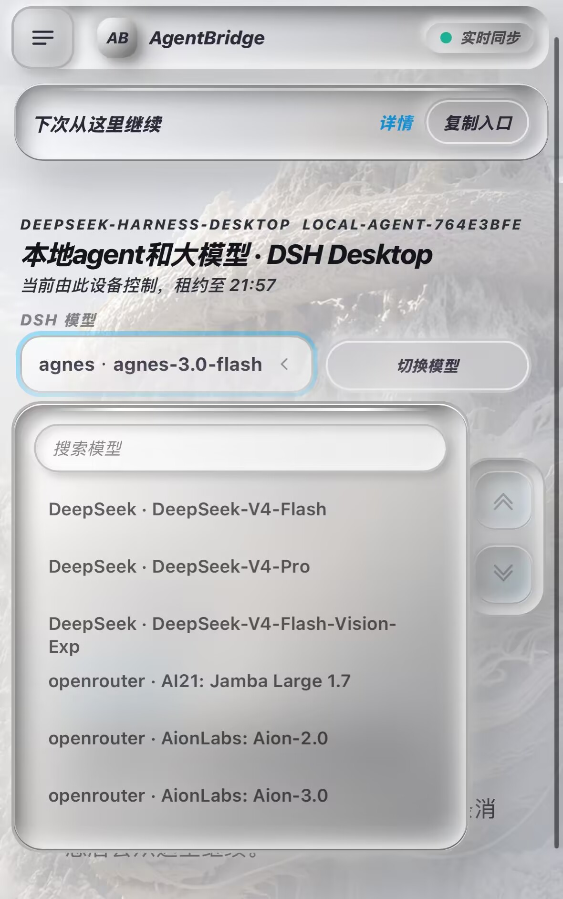

# @chenacc/dsh-agentbridge

[](https://www.npmjs.com/package/@chenacc/dsh-agentbridge)
[](./LICENSE)
[](https://github.com/chenacc1/agentbridge/stargazers)

AgentBridge 的 DSH Desktop 集成插件。在某个项目会话里执行 `/phone`，把**屏幕上那一条** live Agent 会话接到手机控制台：手机扫码后可以发消息、审批、切换模型、停止任务，桌面与手机看到同一份事件流。



一条命令装进当前 profile：

```powershell
cd "$env:USERPROFILE\.dsh\profiles\desktop"; pnpm add @chenacc/dsh-agentbridge@latest
```

重启 DSH Desktop，在项目会话里输入 `/phone`——二维码默认就是公网地址，手机用流量也能打开。

- 精确绑定当前会话：会话 ID、项目目录、provider / 模型都取自真实会话，不是新建一个"类似的"会话。
- 电脑始终是唯一执行端：凭据和文件访问留在本机，手机只下发命令。

> 觉得有用就给主仓库点个 star：[chenacc1/agentbridge](https://github.com/chenacc1/agentbridge) —— 不影响任何功能。

## 前置条件（重要）

这个插件**只是一个桥接层**，真正的服务端是本机运行的 AgentBridge 桥（默认 `http://127.0.0.1:8787`）。

从 0.2.0 起，桥作为依赖随插件一起安装，**DSH Desktop 启动时插件会自己在后台把桥拉起来**，所以正常情况下你什么都不用敲，重启桌面后直接 `/phone` 就行。

从 0.3.0 起，插件默认还会**自动开一条 Cloudflare 隧道**，把桥映射成一个公网 https 地址——手机用流量、在外地都能扫码打开，不必和电脑连同一个 Wi-Fi。

这一步需要一个叫 `cloudflared` 的小工具（Cloudflare 官方客户端）。**你不用管它**：插件会先在本机找，找不到就自己从 Cloudflare 官方的 GitHub Releases 下载一份到 `~\.agentbridge\bin\cloudflared.exe`（约 55 MB，只下一次，不用管理员权限，删掉那个文件夹就等于卸载）。下载完还会跑一次 `cloudflared --version` 验证，验不过的文件不会留在磁盘上。

想自己装也行，插件优先用系统里已有的那份：

```powershell
winget install --id Cloudflare.cloudflared
```

下载不到（断网、公司代理拦着）也能用，只是退回到"手机和电脑同一个 Wi-Fi"，日志里会说明原因。

只有自动启动失败时（沙箱限制、端口被占、装在非常规位置）才需要手动起桥：

```powershell
npx @chenacc/agentbridge
```

想长期用、或要改配置（项目白名单、远程通道、通知推送）：

```powershell
npm install -g @chenacc/agentbridge
agentbridge phone --agent claude
```

也可以从仓库跑：`git clone` → `npm install` → `npm start`。

桥起不来时 `/phone` 会把上面这些命令直接印在会话里，不会让你对着一个报错发呆。

要求：DSH Desktop 已安装（存在 `%USERPROFILE%\.dsh\profiles\desktop\package.json`），Node.js 22+。

## 安装

通过 DSH Desktop 的插件市场安装，或手动装进当前 profile：

```powershell
cd "$env:USERPROFILE\.dsh\profiles\desktop"
pnpm add @chenacc/dsh-agentbridge@latest
```

然后确认 profile 的 `package.json` 里有：

```json
{
  "dsh": { "profile": { "bundles": ["@deepseek-ai/dsh-base", "@deepseek-ai/dsh-web-app", "@chenacc/dsh-agentbridge"] } }
}
```

改完重启 DSH Desktop 才会加载命令。

## 使用

1. 重启 DSH Desktop。几秒后插件会把桥拉起来，再开一条 Cloudflare 隧道，二维码里就是公网地址——手机用 Wi-Fi 或流量都能打开。
2. 在 DSH Desktop 里打开目标项目会话，输入 `/phone`。
3. 会话里出现一次性二维码（5 分钟有效、只能用一次）。用微信扫一扫，进入手机控制台。
4. 配对成功后，下次直接从手机页进入，不必再扫。

关于公网地址，有两件事值得知道：

- **地址会变。** `trycloudflare.com` 的免费域名每次隧道重建都会换一个，所以别把旧地址当书签。要保持固定地址，去 Cloudflare 建一条命名隧道，然后把 `AGENTBRIDGE_PUBLIC_ORIGIN` 设成自己的域名（这时插件就不再自己起隧道）。
- **它是对公网开放的。** 所以插件在开隧道时**强制打开访问密钥**，二维码里带着 `?key=…`；拿到二维码的人就能控制这台电脑，别截图外传。

## 配置

| 变量 | 默认值 | 含义 |
|---|---|---|
| `AGENTBRIDGE_ORIGIN` | `http://127.0.0.1:8787` | 插件连接的 AgentBridge 地址；桥换了端口时设置它 |
| `AGENTBRIDGE_DATA_DIR` | `~/.agentbridge`（自动启动时） | 桥的会话、配对、密钥与日志目录，不会写进 `~/.dsh` |
| `AGENTBRIDGE_NO_AUTOSTART` | 未设置 | 设为 `1` 关掉"插件加载时自动起桥"，只保留 `/phone` 里的手动提示 |
| `AGENTBRIDGE_REMOTE` | `auto` | 走哪条路径：`auto` / `cloudflare` / `named` / `funnel` / `tailscale` / `zerotier` / `lan` |
| `AGENTBRIDGE_NO_TUNNEL` | 未设置 | 设为 `1` 只用局域网（等价于 `AGENTBRIDGE_REMOTE=lan`） |
| `AGENTBRIDGE_PUBLIC_ORIGIN` | 未设置 | 自己指定对外的地址；设了它插件不再挑路径 |
| `AGENTBRIDGE_TUNNEL_URL` | 未设置 | 直接指定一个隧道域名；主要给测试和"隧道自己管"的人用 |
| `AGENTBRIDGE_CLOUDFLARE_TUNNEL` / `AGENTBRIDGE_CLOUDFLARE_HOSTNAME` | 未设置 | 用已经建好的 Cloudflare 命名隧道 + 自己的域名 |
| `AGENTBRIDGE_CLOUDFLARED` | 自动查找 | 用你自己那份 `cloudflared`；设了它插件既不搜索也不下载 |
| `AGENTBRIDGE_NO_DOWNLOAD` | 未设置 | 设为 `1` 禁止插件自动下载 `cloudflared`（会退回局域网） |
| `AGENTBRIDGE_CLOUDFLARED_URL` | 官方 GitHub Releases | 换一个下载源（内网镜像之类）；下载后照样要过 `--version` 校验 |
| `AGENTBRIDGE_TAILSCALE` / `AGENTBRIDGE_ZEROTIER` | 自动检测 | 手动指定 Tailscale 可执行文件 / ZeroTier 的 IPv4 |

路径选择由桥包的 `@chenacc/agentbridge/remote` 负责，CLI 与插件共用同一份实现：同一个顺序、同一把访问密钥。当前实际走的是哪条，看 `/api/health` 的 `remoteProvider` 字段。

变量要设在**真正启动 DSH Desktop 的环境里**（插件读 `process.env`），不是设在跑 bridge 的终端里。

## 卸载

在插件市场里卸载，或：

```powershell
cd "$env:USERPROFILE\.dsh\profiles\desktop"
pnpm remove @chenacc/dsh-agentbridge
```

并把 `dsh.profile.bundles` 里的 `@chenacc/dsh-agentbridge` 删掉，然后重启 DSH Desktop。

## 兼容性

| 版本 | 需要 |
|---|---|
| 插件 0.1.x | DSH Desktop（`@deepseek-ai/dsh-commands`、`@deepseek-ai/cordis` 由 DSH 提供）、AgentBridge `0.1.x` |
| 插件 0.2.x | 同上；桥随插件安装并由插件自动拉起 |
| 插件 0.3.x | 同上 + 默认开 Cloudflare 隧道；`cloudflared` 缺了自动下载到 `~/.agentbridge/bin` |

当前版本：插件 `0.3.3` / 桥 `0.1.4`。插件把隧道逻辑交给桥包（`@chenacc/agentbridge/tunnel`），所以 CLI 的 `/phone` 和这里用的是同一份实现、同一条隧道、同一把访问密钥。

插件与 bridge 之间有一份集成版本号握手：bridge 侧要求的最低集成版本比插件旧时，手机端会提示"桌面端集成是旧版"，升级插件即可。

## 许可证

MIT
